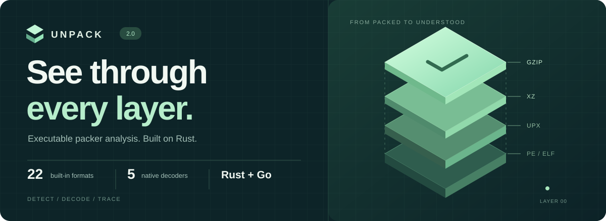
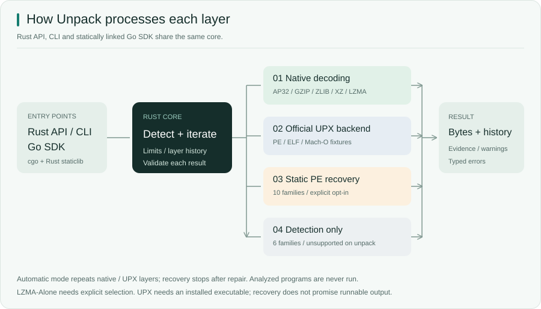
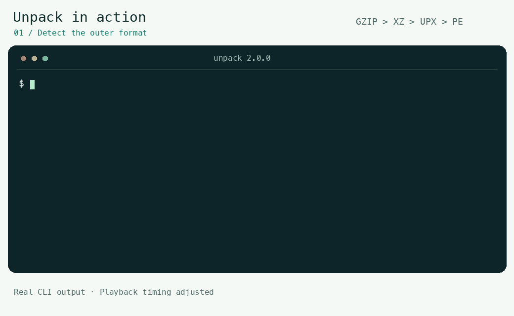
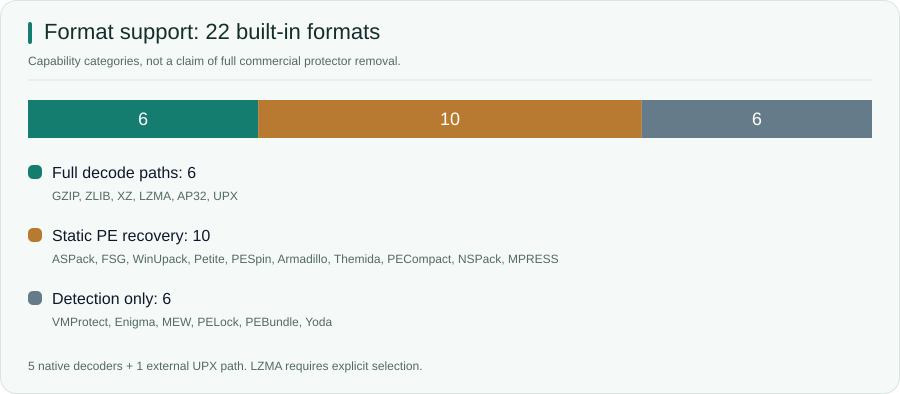
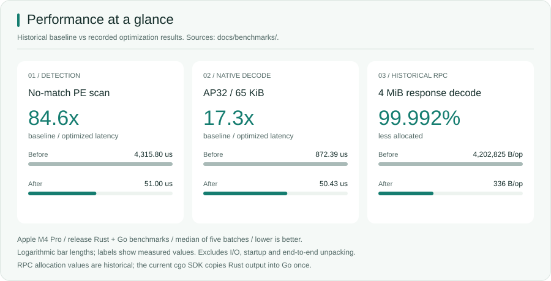

<p align="center">
  <strong>Executable packer analysis · Rust core · Go SDK</strong><br/>
  <a href="README.md">English</a> · <a href="README_zh.md">中文</a>
</p>

<p align="center">
  <a href="#features">Features</a> · <a href="#quick-start">Quick start</a> ·
  <a href="#formats">Formats</a> · <a href="#performance">Performance</a> ·
  <a href="#go-sdk">Go SDK</a> · <a href="docs/REFERENCE.md">Documentation</a>
</p>

Unpack detects executable packers, decodes compressed payloads and records each layer.
Use it through the CLI, Rust library or compatible Go SDK.

<a id="features"></a>

## Features

| Inspect | Decode | Trace | Integrate |
| --- | --- | --- | --- |
| 22 built-in formats | 5 native decoders + UPX | Recursive layers and detection evidence | Rust / Go / CLI |



<a id="quick-start"></a>

## Quick start

Requires Rust 1.85+. Run from the repository directory:

```sh
cargo install --path . --locked
unpack detect --json testdata/upx/pe32.packed
unpack unpack -o output.exe testdata/upx/pe32.packed
```

UPX unpacking also requires [official UPX](https://upx.github.io/). Analyzed executables are never run.

See the [CLI reference](docs/REFERENCE.md#cli) for more options and configuration.

### Demo

Detect the format → decode GZIP / XZ / UPX layers → verify the result.



<a id="formats"></a>

## Supported formats



**Native decode** restores compressed content. **Static recovery** repairs PE entry points
and structure without guaranteeing runnable output. **Detect only** does not unpack.

| Format | Capability | Versions / main variants |
| --- | --- | --- |
| GZIP | Native decode | Single / concatenated members |
| ZLIB | Native decode | DEFLATE streams; no preset dictionaries |
| XZ | Native decode | Single / concatenated streams, x86 BCJ, delta |
| LZMA-Alone | Native decode | Known / unknown size; requires `--format LZMA` |
| AP32 | Native aPLib decode | AP32 containers, nested containers |
| UPX | Official backend | Verified **5.1.0**: PE32/64, ELF32/64/ARM64, x86-64 Mach-O, LZMA, x86 filter |
| ASPack | Static recovery | **2.1, 2.12, 2.42, OTHER** layouts |
| FSG | Static recovery | `FSG!` / `FSG2` signatures |
| WinUpack | Static recovery | `WinUpack` / `UPack` signatures |
| Petite | Static recovery | — |
| PESpin | Static recovery | — |
| Armadillo | Static recovery | — |
| Themida | Static recovery | — |
| PECompact | Static recovery | `PECompact` / `PEC2` / `PEC1` signatures |
| NSPack | Static recovery | — |
| MPRESS | Static recovery | PE32/64; `.MPRESS1` / `.MPRESS2` section layouts |
| VMProtect | Detect only | — |
| Enigma | Detect only | — |
| MEW | Detect only | `MEW11` / `MEW 11` signatures |
| PELock | Detect only | — |
| PEBundle | Detect only | — |
| Yoda | Detect only | Protector / Crypter |

“—” means the exact vendor release is unverified. Signatures and section names are
not vendor versions. ASPack 2.42/OTHER have synthetic layout coverage; real legacy
samples also verify conservative rejection of unsupported recovery. [Full version details →](docs/REFERENCE.md#versions)

<a id="performance"></a>

## Performance



Local Apple M4 Pro microbenchmarks; excludes file I/O, process startup and end-to-end unpacking.
The allocation panel records the former RPC SDK; the current cgo SDK copies Rust output into Go once.
[Methodology, detailed charts and raw data →](docs/REPORT.md)

## Go SDK

Requires Go 1.21.5+, cgo, a C compiler and Rust at build time. Build the embedded Rust
static library once before compiling the SDK:

```sh
python3 scripts/build_go_sdk.py  # or: make sdk / go generate .
go build ./examples/go
```

The Go application contains the Rust core; no `unpack` executable is needed at runtime.
UPX unpacking still requires official UPX. [Build and platform details →](docs/REFERENCE.md#go-sdk)

```go
package main

import (
    "fmt"
    "github.com/orca-zhang/unpack"
    _ "github.com/orca-zhang/unpack/drivers"
)

func main() {
    result, err := unpack.UnpackAll("packed.exe")
    if err != nil { panic(err) }
    for _, layer := range result.History {
        fmt.Println(layer.PackerName, layer.Support)
    }
    for _, warning := range result.Warnings { fmt.Println(warning) }
}
```

Legacy Go calls allow static recovery by default; the CLI does not. See the
[SDK reference](docs/REFERENCE.md#go-sdk) for strict mode, registration and other options.

For more examples, see the [Rust example](examples/basic.rs) and [Go example](examples/go/main.go).

## Documentation

- [Version details, CLI flags and SDK options](docs/REFERENCE.md)
- [Benchmark report](docs/REPORT.md)
- [Test fixtures and regeneration](testdata/README.md)

## Repository layout

| Path | Contents |
| --- | --- |
| [rust/](rust/) | Rust core and CLI |
| [drivers/](drivers/) | All 22 Go format drivers and their registration entry point |
| [native/](native/) | C header and generated Rust libraries for the Go SDK |
| [internal/](internal/) | Shared Go test helpers |
| [examples/](examples/) | Rust and Go usage examples |
| [tests/](tests/) | Rust integration tests; Go tests live beside their packages |
| [testdata/](testdata/) | Shared fixtures, manifests and provenance |
| [scripts/](scripts/) | Build, fixture, benchmark and chart tools |
| [docs/](docs/) | Reference docs, benchmark reports and images |

Go SDK sources and Cargo/Go manifests stay at the root for standard build commands.
Individual Go drivers use paths such as `github.com/orca-zhang/unpack/drivers/upx`.

## License

[MIT](LICENSE). Official UPX is a separate executable with its own license.
