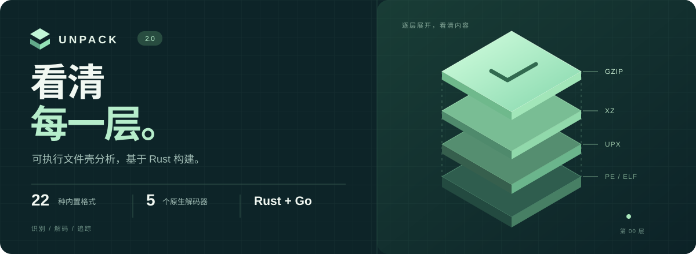
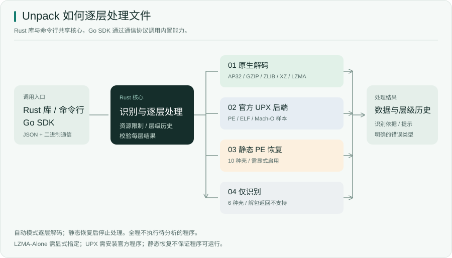
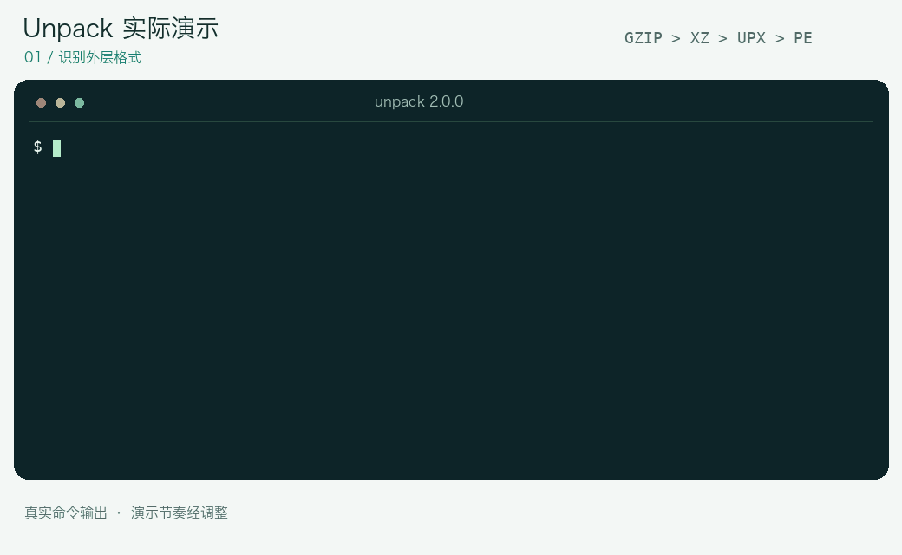
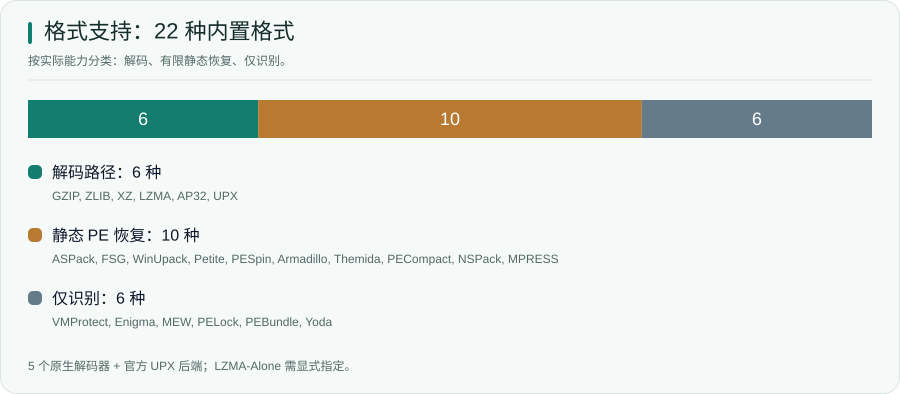
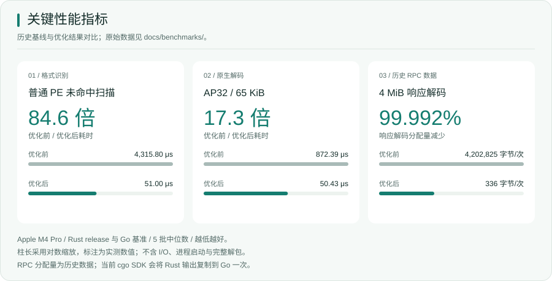

<p align="center">
  <strong>可执行文件壳分析 · Rust 核心 · Go SDK</strong><br/>
  <a href="README.md">English</a> · <a href="README_zh.md">中文</a>
</p>

<p align="center">
  <a href="#features">功能</a> · <a href="#quick-start">快速开始</a> ·
  <a href="#formats">支持格式</a> · <a href="#performance">性能</a> ·
  <a href="#go-sdk">Go SDK</a> · <a href="docs/REFERENCE_zh.md">详细文档</a>
</p>

Unpack 用于识别可执行文件的壳、解码压缩载荷，并逐层记录处理结果。提供命令行、Rust 库和兼容原接口的 Go SDK。

<a id="features"></a>

## 功能

| 识别 | 解码 | 追踪 | 集成 |
| --- | --- | --- | --- |
| 22 种内置格式 | 5 个原生解码器 + UPX | 多层处理与识别依据 | Rust / Go / CLI |



<a id="quick-start"></a>

## 快速开始

需要 Rust 1.85+，在仓库目录内执行：

```sh
cargo install --path . --locked
unpack detect --json testdata/upx/pe32.packed
unpack unpack -o output.exe testdata/upx/pe32.packed
```

解包 UPX 文件还需安装[官方 UPX](https://upx.github.io/)。处理过程中不会执行待分析的程序。

更多参数和环境配置见[命令行说明](docs/REFERENCE_zh.md#cli)。

### 演示

识别格式 → 解开 GZIP / XZ / UPX 三层 → 校验结果。



<a id="formats"></a>

## 支持格式



**原生解码**直接还原压缩内容；**静态恢复**仅修补 PE 入口和结构，不保证程序可运行；**仅识别**不提供解包。

| 格式 | 能力 | 版本 / 主要变体 |
| --- | --- | --- |
| GZIP | 原生解码 | 单成员、多成员 |
| ZLIB | 原生解码 | DEFLATE 流；不支持预置字典 |
| XZ | 原生解码 | 单流、多流、x86 BCJ、delta |
| LZMA-Alone | 原生解码 | 已知 / 未知长度；需 `--format LZMA` |
| AP32 | 原生 aPLib 解码 | AP32 容器、嵌套容器 |
| UPX | 官方后端解包 | 已验证 **5.1.0**：PE32/64、ELF32/64/ARM64、x86-64 Mach-O、LZMA、x86 filter |
| ASPack | 静态恢复 | **2.1、2.12、2.42、OTHER** 布局 |
| FSG | 静态恢复 | `FSG!` / `FSG2` 签名 |
| WinUpack | 静态恢复 | `WinUpack` / `UPack` 签名 |
| Petite | 静态恢复 | — |
| PESpin | 静态恢复 | — |
| Armadillo | 静态恢复 | — |
| Themida | 静态恢复 | — |
| PECompact | 静态恢复 | `PECompact` / `PEC2` / `PEC1` 签名 |
| NSPack | 静态恢复 | — |
| MPRESS | 静态恢复 | PE32/64；`.MPRESS1` / `.MPRESS2` 节布局 |
| VMProtect | 仅识别 | — |
| Enigma | 仅识别 | — |
| MEW | 仅识别 | `MEW11` / `MEW 11` 签名 |
| PELock | 仅识别 | — |
| PEBundle | 仅识别 | — |
| Yoda | 仅识别 | Protector / Crypter |

“—”表示未验证具体发行版；签名和节名不代表厂商版本。[完整版本明细 →](docs/REFERENCE_zh.md#versions)

ASPack 2.42/OTHER 目前仅有合成布局测试；真实旧壳样本还验证无法可靠恢复时会明确报错。

<a id="performance"></a>

## 性能



数据来自 Apple M4 Pro 上的本机微基准，不含文件 I/O、进程启动和完整解包。
[测量方法、详细图表与原始数据 →](docs/REPORT.md)

分配量面板保留的是旧 RPC SDK 的历史数据；当前 cgo SDK 会将 Rust 输出复制到 Go 一次。

## Go SDK

构建需要 Go 1.21.5+、cgo、C 编译器和 Rust。先构建嵌入 SDK 的 Rust 静态库：

```sh
python3 scripts/build_go_sdk.py  # 或 make sdk / go generate .
go build ./examples/go
```

Rust 核心会编译进 Go 应用，运行时无需 `unpack` 程序。UPX 解包仍需官方 UPX。
[构建与平台说明 →](docs/REFERENCE_zh.md#go-sdk)

```go
package main

import (
    "fmt"
    "github.com/orca-zhang/unpack"
    _ "github.com/orca-zhang/unpack/drivers"
)

func main() {
    result, err := unpack.UnpackAll("packed.exe")
    if err != nil { panic(err) }
    for _, layer := range result.History {
        fmt.Println(layer.PackerName, layer.Support)
    }
    for _, warning := range result.Warnings { fmt.Println(warning) }
}
```

旧 Go 接口默认允许静态恢复，CLI 默认关闭。严格模式、驱动注册和其他选项见 [SDK 文档](docs/REFERENCE_zh.md#go-sdk)。

Rust 库用法见 [Rust 示例](examples/basic.rs)，完整 Go 示例见 [examples/go](examples/go/main.go)。

## 更多文档

- [版本明细、命令行参数与 SDK 选项](docs/REFERENCE_zh.md)
- [性能报告](docs/REPORT.md)
- [测试样本与生成方法](testdata/README.md)

## 目录结构

| 路径 | 内容 |
| --- | --- |
| [rust/](rust/) | Rust 核心与命令行 |
| [drivers/](drivers/) | 全部 22 种 Go 格式驱动及统一注册入口 |
| [native/](native/) | Go SDK 使用的 C 头文件与生成的 Rust 静态库 |
| [internal/](internal/) | Go 测试共用工具 |
| [examples/](examples/) | Rust、Go 使用示例 |
| [tests/](tests/) | Rust 集成测试；Go 测试与对应包放在一起 |
| [testdata/](testdata/) | 统一存放测试样本、清单与来源说明 |
| [scripts/](scripts/) | 构建、样本生成、基准测试和图表工具 |
| [docs/](docs/) | 参考文档、性能报告与图片 |

Go SDK 源码及 Cargo、Go 配置保留在根目录，方便使用标准构建命令。
单独导入 Go 驱动时使用 `github.com/orca-zhang/unpack/drivers/upx` 这样的路径。

## 许可证

[MIT](LICENSE)。官方 UPX 作为独立程序使用，适用其自己的许可证。
