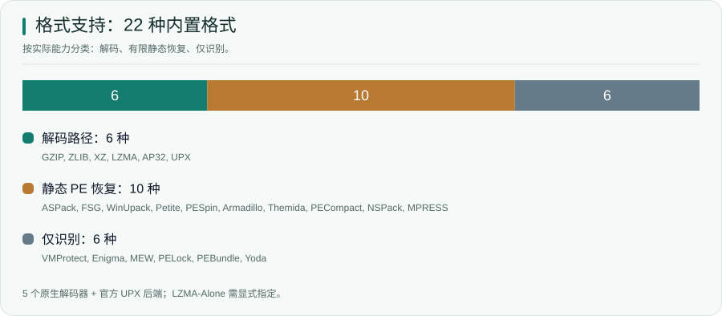
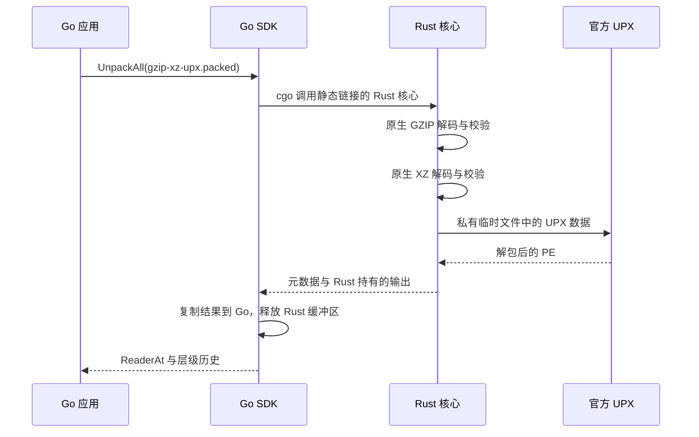
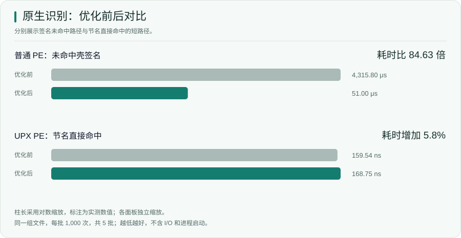
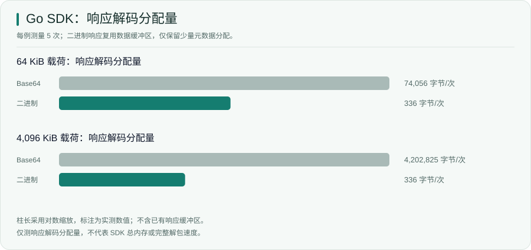

<p></p>

# 实现与性能图表

[项目首页](../README_zh.md) · [完整格式与版本表](../README_zh.md#formats) · [English](../README.md)

当前实现新增 GZIP、ZLIB、XZ、LZMA-Alone 载荷解码，扩展 UPX 的 ELF32、ARM64 ELF、
x86-64 Mach-O 样本，并优化 AP32 校验和。Go 仅保留 SDK，通过 cgo 静态链接 Rust 核心。
图表来自实际格式表、样本文件和本机测量，原始数据保存在本目录。
性能对比的柱长采用对数缩放，数值与倍率保留实测值；格式分布和样本大小仍按比例绘制。


| 图表 | 读图重点 | 数据来源 |
| --- | --- | --- |
| [功能流程](charts/workflow-zh.svg) | 原生解码、外部 UPX、静态恢复、仅识别的区别 | [实际格式列表](formats.json)与 Rust 处理路径 |
| [支持分布](charts/support-zh.svg) | 6 条解码路径、10 种恢复、6 种仅识别 | [formats.json](formats.json) |
| [样本大小](charts/upx-fixtures-zh.svg) | 8 个真实 UPX 变体；不作为通用压缩率结论 | [UPX 清单](../testdata/upx/manifest.json)与样本文件 |
| [AP32 / CRC 耗时](charts/ap32-decode-zh.svg) | 对数柱长，标注为真实数值，越低越好 | [优化前](benchmarks/codecs-before.json) / [优化后](benchmarks/codecs-after.json) |
| [识别耗时](charts/native-detection-zh.svg) | 同时展示未命中路径改善和短路径的轻微回退 | [基线](benchmarks/baseline.json) / [优化后](benchmarks/optimized.json) |
| [SDK 分配量](charts/sdk-allocations-zh.svg) | 旧 RPC 架构的历史分配数据，不代表当前 SDK | [rpc.txt](benchmarks/rpc.txt) |

## 实际能力




22 种内置格式中，AP32、GZIP、ZLIB、XZ、LZMA-Alone 由 Rust 原生解码，UPX 使用官方外部程序。
10 种旧壳仅做有限静态 PE 恢复，另有 6 种只识别。载荷编解码能力与完整 PE 壳恢复是不同的能力：
新增 LZMA 或 aPLib 解码，不等于已经完整实现所有使用这些算法的保护壳。

ASPack 按 2.1、2.12、2.42、OTHER（`0x41f`）四种布局区分恢复字段。
FSG、WinUpack、PECompact 的 `version` 是兼容签名编号，MPRESS 的节名后缀也不是厂商版本。
详细布局偏移、UPX 5.1.0 的 8 个变体，以及 PE / ELF / Mach-O 结构范围见[版本明细](REFERENCE_zh.md#versions)。

LZMA-Alone 没有可靠魔数，需 `--format LZMA`、Go `Options{Format: "LZMA"}` 或命名驱动；
显式选择只处理一层。XZ/LZMA 字典与模型有独立的 64 MiB 内存上限，输出还受 `max_size` 限制。
GZIP、ZLIB、XZ 校验其格式中的完整性字段；LZMA-Alone 本身没有校验和，检查声明长度与严格结束状态。
需要外部预置字典的 ZLIB 暂不支持。



SDK 的文件读取、检测、递归、解码和恢复都在 Rust 中完成，结果复制到 Go 一次。
Go 自定义解包实现和 Go CLI 已移除，内置驱动保留为 SDK 适配器。
运行时无需 Rust 可执行程序；UPX 解包仍使用官方外部程序。

## 样本与实际覆盖


8 个 UPX 变体来自无害的 `testdata/src/tiny.c`，覆盖 PE32/64、ELF32/x86-64/ARM64、
x86-64 Mach-O、LZMA 方法与 x86 filter `0x16`。生成器检查 UPX 实际选择的方法/过滤器，
并保留官方解码结果。UPX 可能规范化文件头，完整文件未必与加壳前字节相同。

Mach-O 生成使用上游实验选项 `--force-macos`，只验证解包字节和结构，不证明加壳程序能在 macOS 运行。
ARM64 Mach-O 候选被上游解码器拒绝，因此未列为已验证往返支持。通用 Mach-O、大小端及 32/64 位
结构由合成测试覆盖，不作为真实通用程序脱壳的证明。

另有 5 组经独立解码器核对的 AP32/raw aPLib 向量，以及 20 个 Python 标准编解码器生成并往返校验的
载荷案例，包含空流、多成员、多流、XZ BCJ/delta/SHA-256、已知长度 LZMA、容器到 UPX 的真实数据链。
测试会拒绝畸形输入、截断、尾随数据、错误校验和、非法字典大小和过量输出。所有测试只解码，不运行样本。

PE 版本矩阵新增 105 个合成用例（ASPack 四种布局 81 例），覆盖偏移、节顺序、导入表、
截断、歧义和块边界；另有来自 MIT 许可 RetDec 语料的 16 个真实样本，覆盖 ASPack 2.12、
FSG 1.33、MPRESS 1.05/1.27/2.05/2.19 与 LZMA/LZMAT。真实样本用于验证识别及拒绝
不可靠恢复：MPRESS 桩内跳转和压缩节内目标不得作为原始入口点。
ASPack 2.42/OTHER 目前只有合成布局覆盖。静态恢复不等于完整解压。

样本较小且数据重复度高，压缩比不能外推到真实软件。AP32 测试编码器主要发出 literal，
不参与压缩比比较。来源与重建方法见 [样本说明](../testdata/README.md)。

## AP32 解码优化


用 `crc32fast` 替代逐位循环，校验多项式与结果不变。以下数据来自 Apple M4 Pro、release 构建，
同一 65 KiB 输入重复 5 批，每批 200 次；先计算每批平均耗时再取中位数。

| 路径 | 优化前 | 优化后 | 本机微基准比值 |
| --- | ---: | ---: | ---: |
| CRC32 校验 | 393.21 μs | 0.95 μs | 约 412.7 倍 |
| AP32：两个 CRC + 解码 | 872.39 μs | 50.43 μs | 约 17.3 倍 |

原始记录：[codecs-before.json](benchmarks/codecs-before.json)、[codecs-after.json](benchmarks/codecs-after.json)。
计时包含相应函数内的校验、分配与解码，不包含文件读取、管道、进程启动和其他格式。
热缓存固定样本的结果不是全库、所有输入或端到端加速保证。

## 检测优化



每个结果取 5 批、每批 1,000 次的平均耗时中位数，计时不包含编译和读取文件。

| 路径 | 历史基线 | 当前记录 | 说明 |
| --- | ---: | ---: | --- |
| 普通 PE，所有壳签名均未命中 | 4.32 ms | 51.00 μs | 快速字符串搜索减少无匹配扫描开销 |
| UPX PE，节名直接命中 | 159.54 ns | 168.75 ns | 短路径的绝对差异很小，新增格式判断带来少量开销 |

原始数据：[baseline.json](benchmarks/baseline.json)、[optimized.json](benchmarks/optimized.json)。
机器、命令和输入哈希见 [environment.json](benchmarks/environment.json)。历史基线是在替换签名搜索前
采集的快照，普通重测不覆盖它，不应拿另一台机器的当前测量直接比较。柱长使用对数缩放，数值与比值仍按原始测量值计算。

## Go SDK 静态链接与历史测量

SDK 通过 cgo 链接 `libunpack.a`。Rust 请求分发代码与 CLI 共用，结果由 Rust 持有，
Go 复制一次后释放；运行时不查找 Rust CLI，也不启动 Rust 子进程。
构建需要 Rust、C 编译器、cgo 和 `python3 scripts/build_go_sdk.py`，平台说明见
[SDK 文档](REFERENCE_zh.md#go-sdk)。上下文取消会通知 Rust；UPX 被终止、回收，
原生编解码器在层边界检查取消。



下表与图表保留旧 RPC 协议 1/2 的历史比较；**不代表当前静态链接 SDK 的内存或速度**。
它只测量“已有响应缓冲区 → 解码结果”，不含接收缓冲区、文件 I/O、启动、管道或 Rust 解包。

| Payload | 旧 base64 解码分配 | 旧二进制帧解码分配 |
| --- | ---: | ---: |
| 64 KiB | 74,056 B/op | 336 B/op |
| 4 MiB | 约 4.01 MiB/op | 336 B/op |

历史记录：[rpc.txt](benchmarks/rpc.txt)。当前结果见 [native-sdk.txt](benchmarks/native-sdk.txt)。
当前 SDK 基准使用 `BenchmarkNativeSDK`，
使用 64 KiB / 4 MiB 未加壳零填充文件，包含热缓存文件读取、Rust 调用和输出复制；
不测压缩解码。Go 的 B/op 不包含 Rust 分配器内存，无法直接与旧解码微基准比较。
重测写入 `native-sdk.txt`，历史 RPC 记录保留。

Rust 的 `unpack_owned` / `unpack_format_owned` 继续消费原输入 allocation；
未加壳输入的指针比较测试验证没有初始整文件复制。

## 重建和验证

```sh
python3 scripts/benchmark.py
cargo build --release --locked
python3 scripts/generate_charts.py --engine target/release/unpack
python3 scripts/generate_charts.py --check --engine target/release/unpack
```

图表生成只用 Python 标准库。`formats.json` 由实际 Rust 程序导出，CI 检查格式列表和图表是否过期；
CI 不重跑机器相关的性能基准。SVG 包含标题、描述和数值，可以独立打开或嵌入文档。
